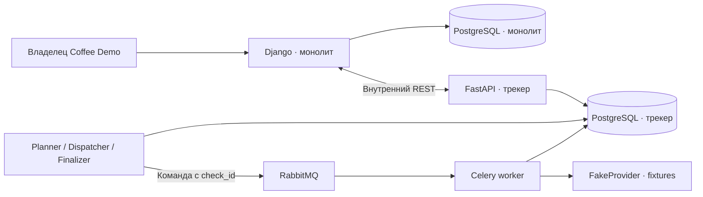
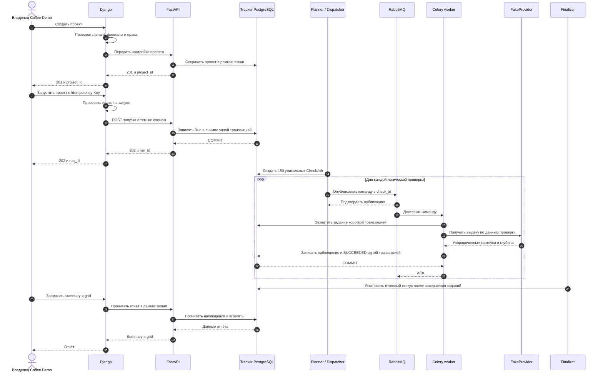

# Продуктовый контракт Local Rank Tracker Lab

## Сценарий Coffee Demo

Владелец компании Coffee Demo в Django отслеживает три филиала сети. У всех карточек одинаковое название `Coffee Demo`, но разные внешние идентификаторы.

| Филиал | Центр WGS84 (широта, долгота) | ID карточки в `fake_maps` |
|---|---|---|
| 101 | 55.7558, 37.6176 | `fake_place_101` |
| 102 | 55.7645, 37.6056 | `fake_place_102` |
| 103 | 55.7317, 37.6055 | `fake_place_103` |

Владелец выбирает запросы «кофейня рядом» и «кофе с собой», одну платформу `fake_maps` и ручной запуск. Для каждого филиала строится своя квадратная сетка 5×5. Координаты филиала совпадают с центром `(row=2, col=2)` при нумерации от 0. `radius_m=2000` задаёт расстояние от центра до края по осям сетки. Углы находятся дальше 2 км от центра.

Один `TrackingRun` фиксирует версию настроек проекта, филиалы и ID карточек, запросы, платформу и геоточки. Планировщик материализует по одному `CheckJob` на комбинацию `run × филиал × запрос × платформа × точка`. Ожидается **150 проверок** (3 × 2 × 1 × 25); для проекта с одним филиалом получится 50. Редактирование проекта после старта влияет только на следующие запуски.

## Границы владения

Django владеет пользователями, tenant, компаниями, филиалами и правами. Трекер владеет проектами, снимками запусков, заданиями, попытками и наблюдениями. Трекер получает данные филиала по доверенному внутреннему REST и работает со своим снимком для конкретного запуска. Обе стороны ограничивают доступ tenant, а Django также проверяет права пользователя в компании. См. [ADR-0001](adr/0001-monolith-and-tracker.md).

## Что считается позицией

Измерение относится к конкретным филиалу, запросу, платформе и точке. FakeProvider отдаёт упорядоченный список карточек для запрошенного окна `top_n` и подтверждённую глубину `complete_to_rank`. Глубина означает, что источник гарантирует полноту позиций от 1 до указанного ранга. Значение 0 означает отсутствие подтверждённого полного префикса. Для demo `top_n=12`, чтобы выборка покрывала позиции по обе стороны границы топ-10.

Ранг начинается с 1. Филиал сравнивается с выдачей по точному совпадению `external_place_id`. Одинаковое название карточки допустимо у разных филиалов. При технически успешном ответе правила применяются сверху вниз.

| Условие в первых `top_n` позициях | Outcome | Rank | Пример |
|---|---|---:|---|
| Целевой ID встречается несколько раз | `AMBIGUOUS` | `null` | Одна карточка на позициях 2 и 4 |
| Целевой ID встречается один раз | `FOUND` | Позиция ≥ 1 | Карточка на второй позиции даёт 2 |
| Целевого ID нет, подтверждён весь запрошенный топ-N | `NOT_FOUND` | `null` | Полный топ-12 содержит карточку другого филиала |
| Целевого ID нет, подтверждена только часть окна или окно пусто | `NO_DATA` | `null` | Доступны 11 из 12 позиций |

При однозначном совпадении в неполной выдаче `FOUND` допустим, если позиция совпавшей карточки известна. Технически успешный ответ с любым outcome завершает задание как `SUCCEEDED` и создаёт одно `PositionObservation`. Временный сбой провайдера приводит к повтору попытки. Исчерпание попыток даёт `FAILED` без наблюдения.

## От запуска до отчёта

Диаграмма показывает успешный путь. Повтор запуска с тем же проектом, ключом и запросом возвращает тот же `run_id`. Повтор Planner сохраняет 150 логических заданий. Повторная доставка команды после успешного COMMIT сохраняет то же единственное авторитетное наблюдение. Подтверждения публикации и обработки — отдельные действия брокера и worker. См. [ADR-0003](adr/0003-celery-rabbitmq-commands.md).

## Как принять результат

- При работающих сервисах ручной запуск на 150 FakeProvider-проверок должен завершиться. Базовый сценарий даёт `COMPLETED`, 150 заданий `SUCCEEDED` и 150 наблюдений. Числовой порог времени зададим после замеров demo.
- Базовый отчёт совпадает с `expected_summary.demo_run` в [fixture выдач](../fixtures/fake_provider_results.json). В выборке 10 заданных выдач сверяются каждый outcome и rank, а общие метрики сравниваются с `expected_summary.explicit_cases`. Остальные 140 комбинаций используют шаблон `default_provider_result`, в котором `$target` заменяется ID текущего филиала. Ранг в списке ID равен индексу плюс один.
- В сценарии сбоя FakeProvider возвращает временную ошибку на первой попытке `found_rank_2`, а на второй отдаёт эталонную выдачу. После успешного retry итоговый отчёт совпадает с базовым и для проверки остаётся одно наблюдение. Повтор HTTP-запроса, повтор планирования и доставка команды после COMMIT также сохраняют базовые числа.
- Пользователь другого tenant не может прочитать проект, запуск или отчёт. `summary` содержит итоговые счётчики, `grid` позволяет сверить outcome и ранг по филиалу, запросу, платформе и точке.

| Показатель | Расчёт |
|---|---|
| Прогресс выполнения | Доля проверок в `SUCCEEDED`, `FAILED` или `CANCELED` от общего числа |
| `valid_checks` | Число `FOUND` и `NOT_FOUND` |
| `data_quality_excluded` | Число `NO_DATA` и `AMBIGUOUS` |
| `coverage_pct` | 100 × `valid_checks` / все запланированные проверки |
| `avg_found_rank` | Сумма рангов `FOUND` / число `FOUND` |
| `top3_pct`, `top10_pct` | 100 × число `FOUND` с рангом ≤ 3 или ≤ 10 / `valid_checks` |

Средняя позиция равна `null`, когда отсутствуют `FOUND`. При нуле пригодных измерений оба показателя топа равны `null`. Если пригодные измерения есть и все они `NOT_FOUND`, топы равны 0%, средняя остаётся `null`. Проценты в fixture округлены до двух знаков, средние — до четырёх. См. [ADR-0002](adr/0002-postgresql-reports.md).
